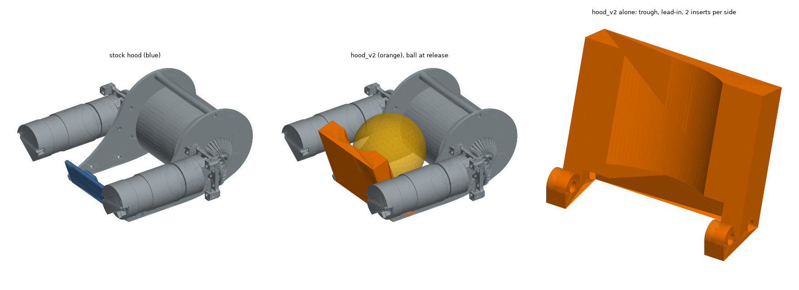
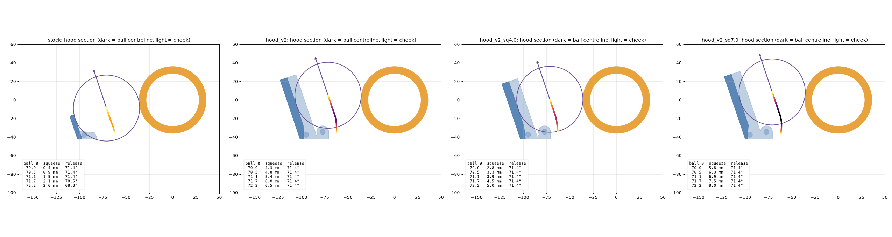

# Launcher V5: hood v2

A drop-in replacement for the small rectangular hood channel at the tail of the Launcher V5 plates.
The ball is pinched between the Ø72 tyres and this part, so it sets both the grip and the launch angle.

## Why

Measured from `Launcher V5.stl` (2026-11-12/13):

| | Stock hood | Hood v2 (default) |
|---|---|---|
| Squeeze, Ø71.1 ball | 1.5 mm | 5.4 mm |
| Squeeze across Ø70.0–72.2 balls | 0.4–2.6 mm | 4.3–6.5 mm |
| Launch angle across Ø70.0–72.2 | 71.4° → 68.8° | 71.4° for all |
| Straight face past the release point | ~3.6 mm | 30 mm |
| Ball centring | Ø74 cutout at the bottom only | R37 trough, full length |
| Mounting | 1 × M4 per side (can pivot) | 2 × M4 per side |

The stock hood barely grips the ball, and the ball leaves the tyre right at the hood's top corner.
Small differences in ball size or grip therefore change both exit speed and launch angle. v2 keeps the
stock 71.4° face angle, so the existing shot tuning stays close. It adds squeeze, and it extends the
straight face far enough that the ball always leaves the tyre while still on the flat.
That makes the launch angle the face angle.

## Files

| File | What |
|---|---|
| `hood_v2.py` | Parametric build123d model. Run with the cad venv: `cad/.venv/Scripts/python.exe cad/launcher_v5/hood_v2.py [extra squeeze values]` |
| `check_hood.py` | Collision check against every launcher part, plus a squeeze / release-angle sweep over ball sizes. Needs scipy, so run it with system Python |
| `render_hood.py` | Shaded views (matplotlib) |
| `out/hood_v2.step/.stl` | Default design, 5.5 mm nominal squeeze |
| `out/hood_v2_sq4.0.*`, `out/hood_v2_sq7.0.*` | Test variants with less and more squeeze |
| `source/launcher_v5.stl` | Copy of the Onshape export, gitignored |

Frame: the Launcher V5 export converted from inches to mm. The flywheel axis runs along Y through the
origin, +Z is up, and the plate tail (and the hood) is toward −X.

## Key parameters (`hood_v2.py`)

`FACE_ANGLE` 71.4°, `SQUEEZE` 5.5 mm, `EXTEND` 30 mm (straight face past release), `LEADIN` 14 mm,
`TROUGH_R` 37, `BACK_T` 8 mm. The bottom edge stays at the stock hood's distance from the axle
(106 mm), so the feed from below meets the same edge. Nothing goes below the plates' bottom edge (Z −42.3).

## Fitting and printing

- Inserts: M4 heat-set inserts in all four 5.6 mm holes, 10 mm deep, from the end faces.
  Holes are at (−94.93, −37.61), which is the stock hole, and (−77.15, −34.34), the spare plate hole.
- Print lying on the flat back face, trough up, so the layer lines run along the ball path.
  PETG or nylon, 4+ walls. The part is ~85 cm³ solid.
- Start with `hood_v2`. If the ball slips or the shots are still inconsistent, try `sq7.0`.
  If the flywheel bogs down or the ball jams, try `sq4.0`. More grip means more exit speed, so re-tune
  `defaultShooterRpm` after fitting.

## Not checked (outside this STL)

- Clearance above and behind the plate tail. The hood now reaches X −123, Z +27; the stock part
  stopped at X −110, Z −16. Check against the turret and anything behind the launcher.
- Whether the spare plate hole at (−77.15, −34.34) is already used on the real robot, for example
  by a turret bracket.
- Where the ball waits before feeding. With more squeeze, the tyre contact zone starts lower.
  Make sure a staged ball doesn't touch the tyre while the flywheel spins up.
