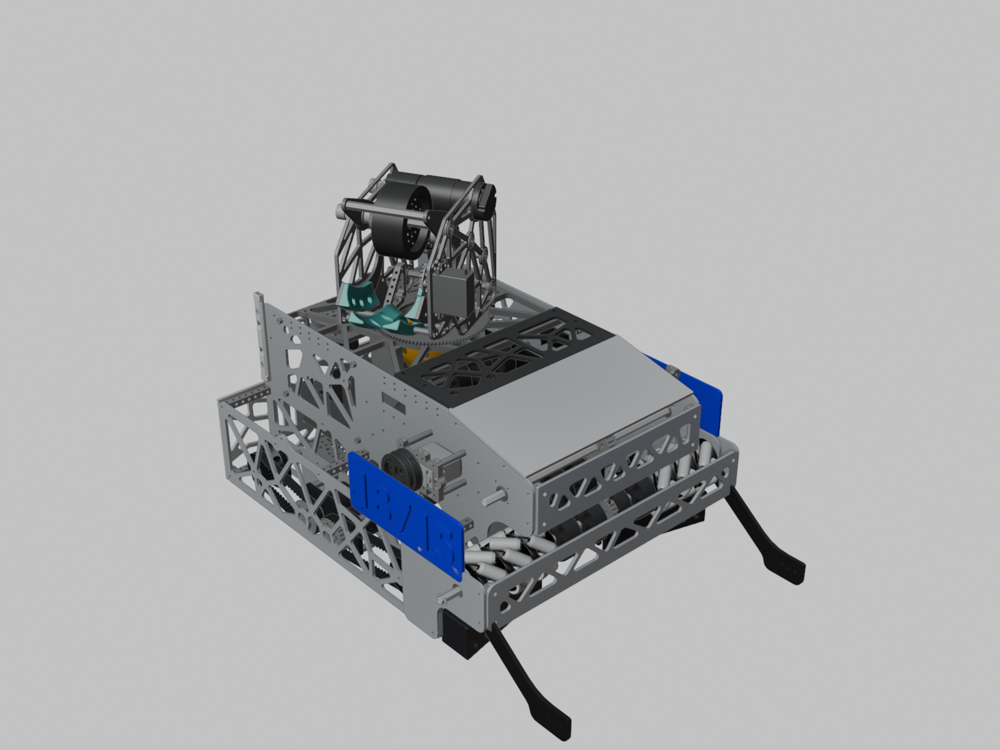

# Robot CAD workspace

Tools for designing new parts against the current robot: load the Onshape export,
query real geometry, model new parts in robot coordinates, check them for collisions,
and render them on the robot.



## Setup (once per machine)

```bash
cd cad
uv venv .venv --python <python 3.12+>        # Python 3.14 works
uv pip install --python .venv/Scripts/python.exe -r requirements.txt
```

Blender 5.2 has to be at `C:/Program Files/Blender Foundation/Blender 5.2/` (path is set in
`tools/robotcad.py` → `BLENDER`).

## Updating the robot model

1. In Onshape, export the top-level assembly as STEP.
2. Copy it to `cad/robot/source/robot.step`. It's gitignored (~95 MB).
3. Run `cad/.venv/Scripts/python.exe cad/robot/tools/extract.py`. It takes about 8 minutes and rebuilds:
   - `source/robot_cache.*`: a BREP cache. Loads in ~4 s instead of ~60 s for the STEP.
   - `index/parts.json` / `parts.csv`: every part's name, colour, world bbox, centre and volume.
   - `index/robot.glb` + `index/robot.blend`: the robot mesh. The `.blend` is what renders start from.
   - `renders/robot_*.png`: overview renders.

## Designing something new

Copy `designs/example_bracket.py`. The loop is:

```python
robot = load_robot()                                   # build123d Compound, names + colours
ref   = find(robot, r"Gecko")                          # regex on part names
(mn, mx, size) = world_bbox(ref[0])
part  = Pos(x, y, z) * Box(...)                        # build123d, robot coordinates, mm
collisions(robot, part)                                # [(part name, overlap mm^3), ...]
export_new("name", {"label": (part, "#ff7a00")}, stl=True)   # designs/out/name.glb/.step/.stl
render("name", views="iso,side", ghost=True)           # renders/name_<view>.png (~25 s)
```

`render()` options:
- `ghost=True` fades the robot so the new part stands out.
- `ghost=False` shows it in solid context.
- `hide=r"regex"` removes existing parts, e.g. the part being replaced.
- `focus=None` frames the whole robot.
- `views` takes any of `iso, iso_back, iso_left, front, back, left, right, side, top, bottom`.
- `save_blend=True` also writes a `.blend` you can open and orbit in Blender.

Orange (`#ff7a00`) is the convention for new parts.

## Coordinate frame (Onshape assembly origin, mm)

| Axis | Direction |
|---|---|
| +X | front: the intake end |
| +Y | robot left |
| +Z | up. Z = 0 is the bottom face of the frame rails and plates |

The overall bbox is about 567 × 384 × 462 mm. That includes the intake arms, which
reach out to X = 351 and Z = −14.
The main frame is X −187…252 and Y ±170, about 439 × 340 mm (17.3" × 13.4").
The top of the shooter is at Z = 370 mm.

## Subsystem map (from the Nov 2026 export)

| Subsystem | Where | Key parts |
|---|---|---|
| **Frame** | full length | Two pairs of 1/8" side plates: inner at Y = ±109.6 (429 mm long, 203 mm tall) and outer at Y = ±168.8 (414 × 113 mm). Front cross plate at X ≈ 250, rear cross plate at X ≈ −186, 1120 U-channel at X ≈ −92, 1106 square beams |
| **Drive** | low, between the outer and inner plates | 4× 5203 Yellow Jacket 1620 rpm (3.7:1) at X = 5 / −38, Y = ±126, Z = 23. Each drives a 24T HTD-5M pulley, with 72T and 59T 9 mm belts running fore/aft to the wheels at X = ±124.5, Y = ±154, Z = 38 (`Component2_step`, Ø54.5 × 24.75) |
| **Odometry** | X ≈ −89, Y ≈ ±50 | 2× spring-loaded A-arm dead-wheel pods (`3110-0001-0002`, 32 mm omni, encoder PCB). Wheel bottom at Z ≈ −11 |
| **Intake** | front, X 185…250 | Custom mecanum-style roller wheels (`roller v3`, mirrored L/R) and 48 mm Gecko wheels on a 264 mm 8 mm REX shaft. Probably driven by the 5203 5.2:1 (1150 rpm) at X = 161, Y = 133, Z = 150 through the 30T miter gears at X ≈ 186. Left/right intake funnels at X ≈ 200, plus dark side arms that reach out to X = 351 |
| **Transfer** | centre, X −74…174, Z 0…190 | Sub-assembly `Transfer <1>`. Ramp of 48 mm Gecko wheels on four 144 mm shafts (X = 27, 66, 110, 160) climbing toward the turret. Two 5203 motors (1:1 6000 rpm and 3.7:1) at X = 95 / 147, Z ≈ 158, plus a 25-2 servo |
| **Turret** | top centre, axis at X = −28, Y = 0 | Sub-assembly `Turret V2 <1>`. 3.5" ID X-contact bearing and a 100T spur gear on the turret plate (Z ≈ 195). Two Axon Max servos at X = −118, Y = ±51 turn it through 90T hub gears and a 38T gear |
| **Shooter** | on the turret, Z 225…370 | `Undershooter <1>`. Yellow Jacket 6000 rpm flywheel motor, 72 mm Rhino wheel flywheel, 32 mm Gecko feed wheels, servo-driven adjusting hood (left/right hood plates; teal static and adjusting hoods) |
| **Electronics** | rear, X ≈ −178 | LED boards, JST connectors and a board at Y = ±113. Power switch bracket at X = 49, Y = 113. **No Control Hub or battery in this export** |
| **Game piece** | in the turret, (−30, −1, 176) | `Pollen`: Ø71 mm yellow ball |
| **Number plates** | sides, Y = ±173 | Blue 165 × 64 mm plates |

### Known quirks of this export
- Onshape flattens most of the tree. Many parts are just called `Part_1`, so find them by
  size and position (see `example_bracket.py`) rather than by name. Only `Turret V2`,
  `Undershooter`, `Transfer`, the odometry pods, the motors, servos and bearings stay
  grouped as sub-assemblies.
- A tiny stray `Part_1` sits at (−212, 76, −88), well below the robot. The renderer
  leaves it out when framing views.
- The drive wheels (`Component2_step`) are only Ø54.5 mm, centred at Z = 38. Their
  bottom is at Z ≈ 11, which is *above* the frame bottom (Z = 0) and the dead wheels
  (Z ≈ −11). They're probably placeholder or hub geometry, so the real floor height
  isn't settled. Check before designing anything that depends on ground clearance.

## Tools

| Tool | What it does |
|---|---|
| `tools/robotcad.py` | Library: `load_robot`, `find`, `world_bbox`, `collisions`, `export_new`, `render(hide=..., hide_boxes=...)` |
| `tools/render.py` | Headless Blender renderer. `--hide-boxes` drops parts with generic names like `Part_1` by position |
| `tools/section.py` | Orthographic cut-away view through any plane (Blender) |
| `tools/extract.py` | Rebuilds the index, cache, GLB and `.blend` from a new STEP |

Extra STEP files that aren't part of the main assembly (for example the flower ramp) go in
`source/extra/`.

## Designs

- `designs/flower_arm.*`: servo direct-drive flower arm. See [flower_arm.md](designs/flower_arm.md).
- `designs/example_bracket.py`: a template for new designs.

## Interactive viewing

- Open `index/robot.blend` (or any `save_blend=True` output) in Blender to orbit it.
- With the Blender MCP connected, Claude can also load these files into your live
  Blender session.
