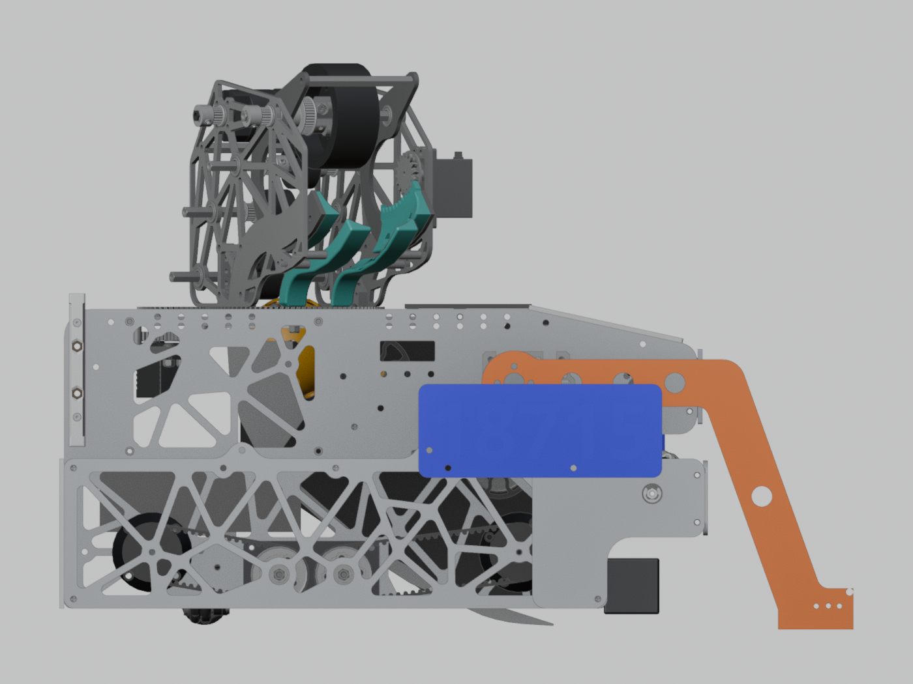
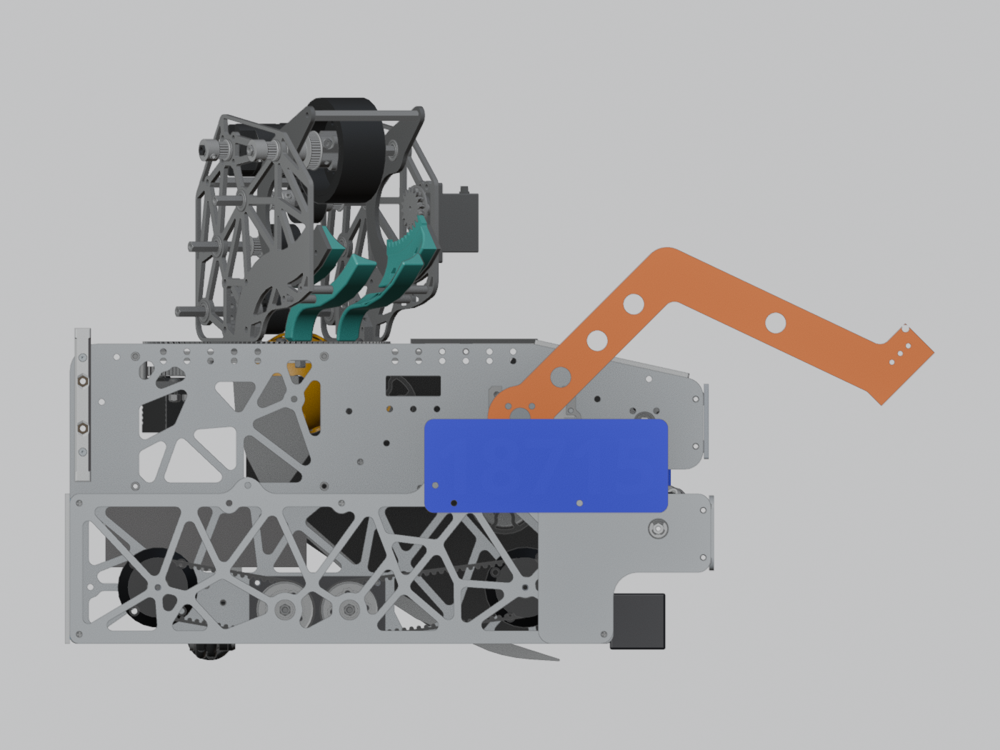
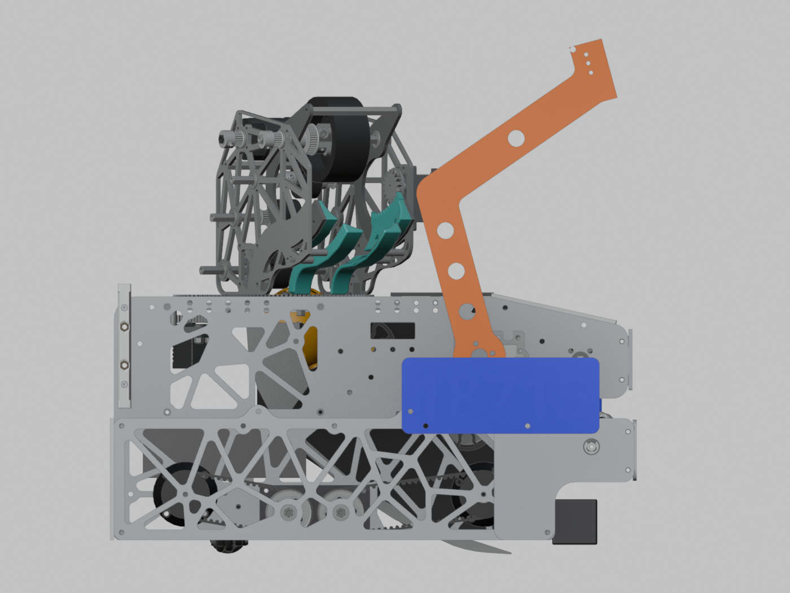
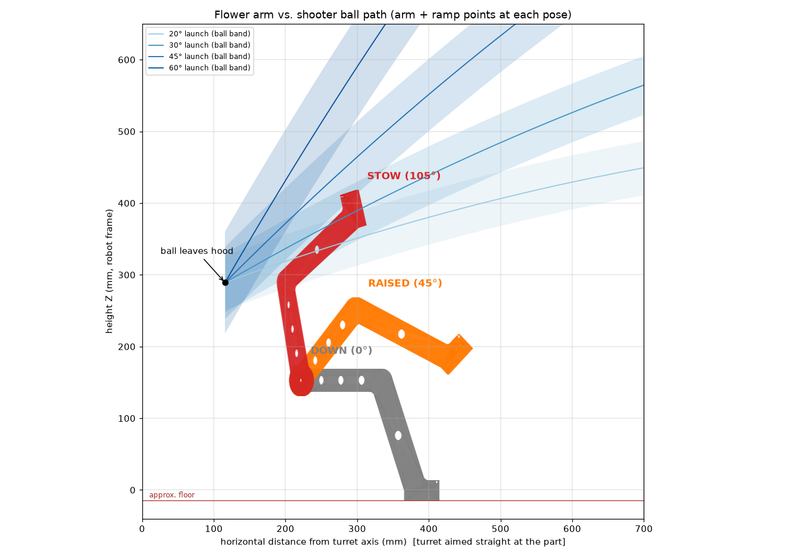

# Flower arm v1: servo direct drive

Generated by `flower_arm.py`. Re-run the chain with:

```bash
cad/.venv/Scripts/python.exe cad/robot/designs/flower_arm.py --analyse --export
cad/.venv/Scripts/python.exe cad/robot/designs/flower_arm_diagram.py
```

| DOWN (0°) | RAISED (45°) | STOW (105°) |
|---|---|---|
|  |  |  |

## What changed

The old arms pivoted on the intake axle and were pulled up by string from the goBILDA
dual-spool winch. The new arms pivot on the flower servo's own axis (X 121.0, Z 152.9) and are
driven straight off the spline. Each arm runs forward above the outer side plate and the intake
axle, turns down 16 mm ahead of the front bumper plate, and ends in the **same tip foot**. In the
DOWN pose the three ramp holes sit exactly where they are today: (325.9, 1.5), (334.1, 1.7) and
(341.6, 1.5). The inner faces are unchanged too (Y −162.36 and +161.12), so the existing flower
ramp bolts on with no changes.

## New parts

| Part | Notes |
|---|---|
| Right arm (orange) | 6 mm plate, inner face at Y −162.36. The 3 mm boss carries a goBILDA 4×M4 pattern (16 mm square) that bolts to a servo hub |
| Left arm (orange) | Same profile, mirrored to Y +161.12…167.12. Has a 14 mm bore for a 1611 flanged bearing (8 mm REX ID) |
| Left idler bracket (orange) | 4 mm plate. Bolts with 2× M4 into the tapped holes on the outboard face of the left intake quad block (1201-0043-0002). Carries an 8 mm pivot pin coaxial with the servo |
| goBILDA 1908-0025-0032 servo hub | Replaces the 3410 winch pulley on the servo spline |
| 8 mm pin, 1611 bearing, M4 hardware | Standard COTS parts |

STLs: `out/flower_arm_right_arm.stl`, `out/flower_arm_left_arm.stl` and `out/flower_arm_bracket.stl`.
STEP with everything in the DOWN pose: `out/flower_arm_down.step`.

**Removed:** both old arms, their pivot bearings and shims on the intake axle, and the winch
pulley. The intake axle keeps its own bearings in the side plates.

## Checks (`out/flower_arm_analysis.txt`)

- **Collisions:** none with any robot part from 0° to 155° of rotation (checked in 5° steps).
  The bracket, hub and pin are clear of the robot.
- **Turret:** at every turret yaw, the arm and ramp stay ≥ 55 mm outside the shooter's swept
  volume up to 105°. Past ~160° the ramp would hit the shooter, so keep the servo limits short
  of that.
- **18" start box:** fits at ≥ 100°. STOW = 105° (front of ramp at X 236, 34 mm margin; top at
  Z 418).
- **Shooter:** the ball leaves the hood 115.6 mm from the turret axis at Z 289 (from a section
  through the Undershooter). The current hood is ≈ 30° elevation. Every turret yaw is
  considered, with a 71 mm ball, a 10 mm margin, and exit speeds of 6 m/s, 9 m/s and a
  straight line:

| Pose | Blocks launch angles | Ramp bottom Z |
|---|---|---|
| DOWN 0° | none | −2.8 (same as today) |
| RAISED 45° | below 9° only (nobody shoots that flat) | 171 |
| STOW 105° | 5°–51° when aimed toward the front corners | 369 |



**Takeaway:** in the match, use RAISED (45°), not STOW. RAISED is completely out of the shot
path. STOW is only for fitting in the 18" box. Any pose that fits 18" sits in the shot path,
because the pivot and the tip holes are both fixed. So drop to RAISED before the first shot
in auto. It's a 60° servo move, about 0.2 s.

## Servo

- goBILDA 2000-0025-0002 (300° in servo mode). DOWN→RAISED = 45° = 0.15 of the servo range.
  DOWN→STOW = 105° = 0.35.
- The old `FlowerBar` positions (UP 0.0 / DOWN 0.655) were for the winch. They have to be
  re-tuned: set DOWN on the robot, then RAISED ≈ DOWN ∓ 0.15 and STOW ≈ DOWN ∓ 0.35. The sign
  depends on servo direction.
- Load estimate: arms ≈ 60 g each (PETG, ~70 % fill), ramp ≈ 70 g. Worst-case holding torque is
  ≈ 0.33 N·m (3.4 kg·cm), against a 25 kg·cm stall.

## Open items / risks

- **One-sided drive:** only the right arm is driven. The left arm follows through the ramp, so
  the ramp carries a small twist. If the left side lags or sags, add a cross-tie between the
  arms above the intake.
- **Number plates:** the arms run 2 mm inboard of the blue number plates. Check the plate
  standoffs on the real robot, since they aren't all in the CAD.
- **Quad block holes:** check that the tapped holes on the quad block's outboard face are free
  on the real robot. The CAD shows 2× M4 threads, about 8 mm deep.
- **Hood range:** the shot analysis uses the hood as modeled. If the adjustable hood can launch
  flatter than ~10°, RAISED would need to go a little lower (40°) or higher (≥ 55°). See
  `out/flower_arm_analysis.txt` for every angle.
- **Expansion rules:** RAISED sticks out to X 402 (150 mm past the front plate), DOWN to
  X 351. Check them against this season's horizontal expansion limit.
